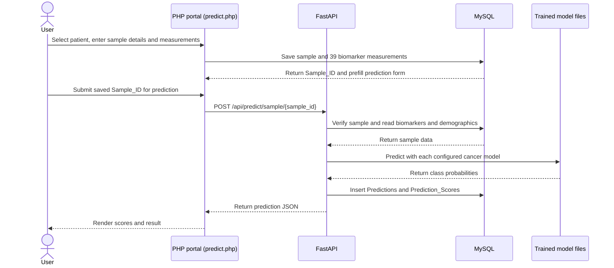

# PHP and FastAPI Model Integration

This guide describes how the PHP prediction page sends a saved sample to the
FastAPI service, how the service prepares model inputs, and where the result is
stored and displayed.

## Request flow



PHP does not load the model files or connect directly to MySQL for this flow.
It sends a database `Sample_ID` to FastAPI. FastAPI reads the sample, runs the
models, saves the prediction, and returns JSON for PHP to display.

## PHP page

`frontend/predict.php` accepts an existing `Patient_ID`, sample metadata, and
the 39 biomarker measurements. The external `Sample_Code` is optional; the
generated `Sample_ID` is used to run a prediction. Measurements can be entered
in the form or provided as a CSV with one header row containing each biomarker
name and unit, followed by one row of non-negative numeric values. Plain
biomarker-name headers from older templates are also accepted. The page saves
the sample and its measurements in one database transaction and prefills its
generated `Sample_ID` in the **Predict an already saved sample** form. PHP
calls the API with it:

```http
POST http://127.0.0.1:8000/api/predict/sample/1
```

The ID is part of the URL path; the request does not need a JSON body. PHP
decodes the JSON response and displays the highest cancer-specific score, the
binary result, the pancancer score, and individual cancer scores. Non-2xx API
responses are shown beside the saved-sample form, so the user can retry without
re-uploading.

The result card includes a link to the patient's page, preserving the exact
`Sample_ID` so its measurements are shown, and a feedback form. Each signed-in
user can submit one response per prediction; the optional suggested cancer and
comment are stored in `Prediction_Feedback`.

The API address defaults to `http://127.0.0.1:8000`. To override it, set
`PREDICTION_API_URL` in the environment of the PHP server process.

## FastAPI endpoint

The route in `backend/app/main.py` is:

```text
POST /api/predict/sample/{sample_id}
```

It passes the path parameter to `run_prediction(sample_id)` in
`backend/app/run_prediction.py`. The endpoint does not accept raw biomarker
values from PHP; it uses the saved sample in MySQL.

The route maps common errors to HTTP responses:

| Status | Meaning |
| --- | --- |
| `404` | No sample exists with that `Sample_ID`. |
| `422` | The sample does not have all required model inputs or supported demographic values. |
| `503` | A database operation failed or a model artifact is missing. |
| `500` | Another prediction error occurred. |

For a MySQL error, FastAPI writes the underlying exception to the Uvicorn
terminal and returns a generic database error to the client.

## Feature preparation and model calls

`run_prediction` first verifies that the requested `Sample_ID` exists.
The service then loads the 39 biomarker measurements ordered by `Biomarker_ID`,
plus the patient's race, sex, omega score, and age. The resulting 43 values are
arranged in the same order used by training:

1. Biomarkers 1 through 39
2. Omega score
3. Age at collection
4. Race code
5. Sex code

The race and sex names must match the categories supported by the training
preprocessing. Incomplete biomarker sets or unsupported demographic values
stop the prediction with a validation error.

The service loads the configured `RandomForestModel.pkl` artifact for each
cancer type and calls `predict_proba`. For each binary model, class 1 is cancer
and class 0 is cancer-free; the model's label is based on which class
probability is greater (a tie is cancer-free). Models are cached after their
first load in the running API process.

Relative `MODEL_PATH` values are resolved from the repository root. The local
`.env.example` uses `MODEL_PATH=Results/test`; the expected artifact layout is:

```text
Results/test/{CancerType}/cancer-healthy/fullModel_all/RandomForestModel.pkl
```

## Saving and returning predictions

The service inserts one overall row into `Predictions` and adds the cancer-
specific values to `Prediction_Scores` in the same transaction. The pancancer
value is stored in `Predictions.Pancancer_Probability`; the eight individual
cancer scores are stored in `Prediction_Scores`. A failed insert rolls back
the save transaction.

The JSON response includes `prediction_id`, `sample_id`, `cancer_scores`,
`highest_cancer_type`, `highest_probability`, `highest_result`,
`pancancer_probability`, and the underlying `model_outputs`. `cancer_scores`
contains the eight cancer-specific model scores; `pancancer_probability` is
the separate pancancer model score. The stored/displayed `highest_result` is
currently taken from whichever configured model has the greatest cancer
probability. PHP uses these summary fields and scores to render the page.

## Run the integrated flow locally

Run these services in separate terminals from the `DECancerPortal` project
directory. Make sure MySQL is running, `.env` contains valid database
credentials, and the configured model artifacts exist.

Start FastAPI:

```sh
source .venv/bin/activate
uvicorn backend.app.main:app --reload
```

Start PHP's built-in web server (PHP cURL support must be enabled):

```sh
php -S 127.0.0.1:3000 -t frontend
```

Open `http://127.0.0.1:3000/predict.php`, sign in, select an existing patient,
fill in the sample details, and upload the biomarker CSV. The old
`test.php` address redirects to this authenticated portal page. A direct API
check can be made with:

```sh
curl -X POST http://127.0.0.1:8000/api/predict/sample/1
```

The sample must exist and contain all 39 biomarker rows, with supported sex and
race values. The API and the PHP server must both be running while using the
page.
